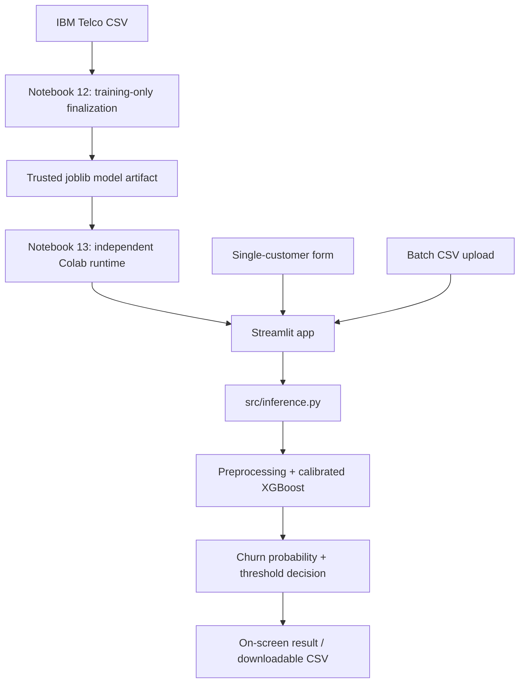

# Customer Churn Prediction

An end-to-end machine-learning project that predicts whether a telecom customer is likely to leave using the IBM Telco Customer Churn dataset.

## Historical Milestone 5 final evaluation (archival)

The final Milestone 5 candidate is **balanced XGBoost with sigmoid probability calibration**. Its decision threshold (**0.344207**) was selected using training-only out-of-fold predictions.

On the project's 1,409-row final comparison set, this configuration achieved:

| Metric | Final model |
|---|---:|
| Accuracy | 76.58% |
| Precision | 54.38% |
| Recall | 72.99% |
| F1-score | 62.33% |
| ROC-AUC | 84.55% |
| Average Precision | 66.30% |

The final model improves accuracy and precision over the historical Milestone 4 threshold-0.53 reference, but has slightly lower recall, F1, ROC-AUC, and Average Precision. It is therefore **not an across-the-board improvement**. These metrics are preserved as an archival record only: the same holdout was already used in Milestone 4 and is permanently excluded from Phase 6 and all subsequent model tuning, calibration, threshold selection, and candidate decisions.

See [the academic final report](docs/FINAL_REPORT.md) for the full methodology, experiment results, limitations, and interpretation. See [PROJECT_STATUS.md](PROJECT_STATUS.md) for the milestone record.

## Project objective

Predict customer churn from customer demographics, subscribed services, contract details, tenure, and billing information. The project demonstrates a reproducible ML workflow from exploratory analysis through model evaluation.

## Dataset

- Source: [IBM Telco Customer Churn dataset (Kaggle)](https://www.kaggle.com/datasets/blastchar/telco-customer-churn)
- Observations: 7,043 customers
- Original columns: 21 (customer identifier, 19 predictors, and churn target)
- Target distribution: 5,174 non-churn customers (73.46%) and 1,869 churn customers (26.54%)
- The raw CSV is not committed to this repository.

Expected filename: `WA_Fn-UseC_-Telco-Customer-Churn.csv`.

## Academic workflow and notebooks

All notebooks are Google Colab-compatible and are stored in `notebooks/`.

| Notebook | Purpose |
|---|---|
| [01 — EDA](notebooks/01_eda.ipynb) | Data quality, target distribution, feature distributions, and exploratory findings |
| [02 — Preprocessing](notebooks/02_preprocessing.ipynb) | Deterministic cleaning, stratified split, and training-fitted preprocessing |
| [03 — Model training](notebooks/03_model_training.ipynb) | Initial model comparison and randomized hyperparameter search |
| [04 — Model evaluation](notebooks/04_model_evaluation.ipynb) | Historical baseline evaluation and training-only threshold selection |
| [05 — Model improvement](notebooks/05_model_improvement.ipynb) | Repeated and nested cross-validation framework |
| [06 — Class imbalance](notebooks/06_class_imbalance_experiments.ipynb) | Balanced versus unweighted model comparisons |
| [07 — Calibration and thresholds](notebooks/07_calibration_threshold_optimization.ipynb) | Nested calibration and F1 threshold experiments |
| [08 — Final evaluation](notebooks/08_final_model_selection_and_evaluation.ipynb) | Finalist freeze and final historical holdout comparison |
| [09 — Feature engineering](notebooks/09_feature_engineering.ipynb) | Training-only comparison of tenure groups and subscribed-service count |
| [10 — Hyperparameter optimization](notebooks/10_hyperparameter_optimization.ipynb) | Nested training-only randomized search for the three retained finalists |
| [11 — Finalist comparison](notebooks/11_finalist_comparison.ipynb) | Strict nested cross-fitting comparison of tuned unweighted and calibrated balanced XGBoost finalists; historical holdout excluded |
| [12 — Final model training](notebooks/12_phase_7a_final_model_training.ipynb) | Training-only final balanced-XGBoost artifact, sigmoid calibration, fresh F1 threshold, and inference smoke tests |
| [13 — Phase 7B Streamlit app](notebooks/13_phase_7b_streamlit_app.ipynb) | Launch the interactive prediction app in a separate Colab runtime by uploading the Phase 7A artifact; no retraining |

Open notebooks directly in Colab using the links below:

- [Open EDA notebook in Colab](https://colab.research.google.com/github/adhishmodi/customer-churn-prediction/blob/main/notebooks/01_eda.ipynb)
- [Open final evaluation notebook in Colab](https://colab.research.google.com/github/adhishmodi/customer-churn-prediction/blob/main/notebooks/08_final_model_selection_and_evaluation.ipynb)
- [Open Phase 7A final training notebook in Colab](https://colab.research.google.com/github/adhishmodi/customer-churn-prediction/blob/main/notebooks/12_phase_7a_final_model_training.ipynb)
- [Open Phase 7B Streamlit app notebook in Colab](https://colab.research.google.com/github/adhishmodi/customer-churn-prediction/blob/main/notebooks/13_phase_7b_streamlit_app.ipynb)

## Methodology

1. Preserve the raw CSV and perform deterministic cleaning on a separate copy.
2. Remove `customerID` and encode `Churn` as a binary target.
3. Create a stratified 80/20 split using random seed 42 (5,634 training rows and 1,409 holdout rows).
4. Fit preprocessing inside complete scikit-learn pipelines: median imputation and standard scaling for numeric features; most-frequent imputation and one-hot encoding for categorical features.
5. Compare candidate classifiers using stratified cross-validation. Hyperparameter search uses training data only.
6. Compare class-balanced and unweighted candidates with repeated cross-validation.
7. Compare probability calibration methods and select an F1 threshold using nested training-only validation.
8. Freeze the finalist and threshold before calculating the final holdout metrics.

The original holdout was previously evaluated in Milestone 4. It must not be used for further tuning, feature selection, calibration, threshold selection, or model selection.

## Local setup

Python 3.12 is recommended (supported range: Python 3.11–3.12).

```powershell
py -3.12 -m venv .venv
.\.venv\Scripts\Activate.ps1
python -m pip install --upgrade pip
pip install -r requirements.txt
```

Place the original CSV at:

```
data/raw/WA_Fn-UseC_-Telco-Customer-Churn.csv
```

Run automated tests:

```powershell
python -m pytest
```

Optional dependencies for explainability, Streamlit, and local notebook tooling are listed in `requirements-optional.txt`. To run the prediction app after installing the optional Streamlit dependency, use `streamlit run app.py` from the repository root. The Phase 7A model artifact must exist at `models/customer_churn_model.joblib`; it is generated by Notebook 12 and is intentionally not committed.

## Phase 7A — final model artifact and inference (completed)

The final candidate is **balanced XGBoost + sigmoid calibration**. Notebook 12 was executed in Google Colab against the original dataset. It reconstructs the original seed-42 stratified split, discards the 1,409-row historical holdout, performs five-fold training-only OOF sigmoid calibration, selects a fresh F1 threshold from those OOF probabilities, and refits the base pipeline on all 5,634 training rows.

Verified execution results:

- Training partition: 5,634 rows from the original 7,043-row dataset.
- Fresh training-OOF decision threshold: **0.3442067252**.
- Training-OOF F1 at the selected threshold: **0.6372663551** (threshold-selection score, not an independent generalization estimate).
- Serialized model artifact size: **57,872 bytes**.
- Saved metadata assertions: passed.
- Serialized artifact reload, synthetic single-customer inference, and synthetic batch inference smoke tests: passed.

Open the [executed Phase 7A notebook in Colab](https://colab.research.google.com/github/adhishmodi/customer-churn-prediction/blob/main/notebooks/12_phase_7a_final_model_training.ipynb) to inspect the recorded outputs.

The generated files `models/customer_churn_model.joblib` and `models/training_metadata.json` are local outputs and are intentionally not committed. The repository's `.gitignore` excludes `models/*` and `*.joblib`; the raw CSV is also excluded.

**Permanent holdout exclusion:** the historical 1,409-row holdout is used only to reconstruct the original stratified split and is discarded immediately. It is never used for fitting, calibration, threshold selection, inference smoke tests, or evaluation. No holdout metrics are generated in Phase 7A. Any future validation must use training-only resampling or a genuinely new external dataset.


## Repository structure

- `notebooks/`: Colab-compatible academic workflow and experiment notebooks
- `src/`: reusable data loading, validation, preprocessing, training, calibration, and evaluation code
- `tests/`: unit and regression tests
- `data/raw/`, `data/processed/`: local data (not committed)
- `models/`, `reports/`: generated artifacts (ignored by Git)
- `docs/FINAL_REPORT.md`: academic project report

## Reproducibility and data-leakage safeguards

- Random seed: 42.
- Use stratified splits for classification.
- Keep learned preprocessing inside the estimator pipeline so each CV fold fits transformations only on its own training rows.
- Use training-only out-of-fold predictions for calibration and threshold selection.
- Do not tune against the final holdout. Any future validation must use training-only resampling or a genuinely new external dataset.

## Project status

Milestones 1–4, Phase 2C, Phase 6, and Phase 7A are complete. Phase 7A's executed Colab notebook records the final training-only artifact build, metadata verification, serialization reload, and synthetic single/batch inference smoke tests. Generated model artifacts remain local and are not committed.

For detailed results and limitations, read [the final report](docs/FINAL_REPORT.md) and [the project status](PROJECT_STATUS.md).


## Phase 7B — interactive prediction app (completed)

The Streamlit app in `app.py` uses the existing Phase 7A inference interface and trusted model artifact. It does not train, tune, recalibrate, or change the decision threshold.

- Single-customer form with the exact 19 inference features.
- Displays calibrated churn probability, predicted Yes/No label, and the threshold stored in the artifact.
- Batch CSV upload with strict feature-schema validation, a 10 MB upload limit, and a 10,000-row limit.
- Downloadable prediction CSV; spreadsheet-formula-like text values are neutralized on export.
- Uploaded customer data is processed in memory and is not persisted by the app.
- The app does not accept uploaded model binaries. Only load the trusted artifact generated by Notebook 12.

### Application architecture



### Running the app in Google Colab

1. Run [Notebook 12](https://colab.research.google.com/github/adhishmodi/customer-churn-prediction/blob/main/notebooks/12_phase_7a_final_model_training.ipynb) and download `customer_churn_model.joblib`.
2. Open [Notebook 13](https://colab.research.google.com/github/adhishmodi/customer-churn-prediction/blob/main/notebooks/13_phase_7b_streamlit_app.ipynb) in its own runtime.
3. Upload the trusted artifact when prompted, then run the setup, dependency-installation, and launch cells.
4. Use the Streamlit interface to submit a single customer or upload a CSV.

Do not upload a joblib file from an untrusted source. The generated model artifact and metadata remain excluded from Git.

### Validation record

- GitHub Actions test workflow passed (run [#43703636079](https://github.com/adhishmodi/customer-churn-prediction/actions/runs/43703636079)).
- Live Colab app launch and single/batch prediction were confirmed by manual execution.
- Four manual CSV cases matched expected behavior: valid input accepted; missing feature, extra column, and invalid numeric value rejected.
- These are application-functionality checks, not model-performance evaluation.

### Portfolio summary

**Customer Churn Prediction — End-to-end ML project**

Built a reproducible telecom churn prediction workflow using the IBM Telco dataset, training-only cross-validation, calibrated balanced XGBoost, and a Streamlit inference app. Implemented single-customer and batch CSV predictions with strict schema validation, bounded uploads, and in-memory processing. Final model uses sigmoid calibration and a training-only selected decision threshold (0.3442067252). Built and tested the workflow in Google Colab; model artifacts and raw customer data are not committed.

**Resume bullet:** Developed an end-to-end customer churn prediction system using Python, scikit-learn, XGBoost, sigmoid calibration, and Streamlit; implemented leakage-aware training/validation, reusable inference, and validated single-record and batch CSV prediction workflows.

### Deployment status

The app has been run successfully in Google Colab. It has **not** been deployed to a permanent public hosting service. Public deployment, if desired, should be treated as a separate phase with an explicit privacy, artifact-delivery, and hosting-cost review.

For a separate local environment, install the optional dependency in an environment where the project dependencies are already installed, then run:

```bash
pip install "streamlit>=1.30"
streamlit run app.py
```

The historical 1,409-row holdout remains permanently excluded from this application phase; no model evaluation or threshold changes are performed here.
